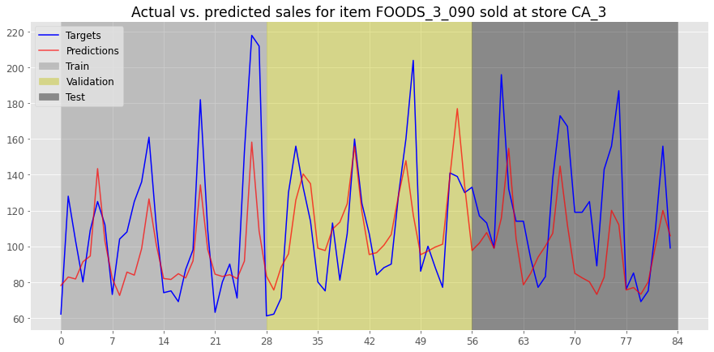
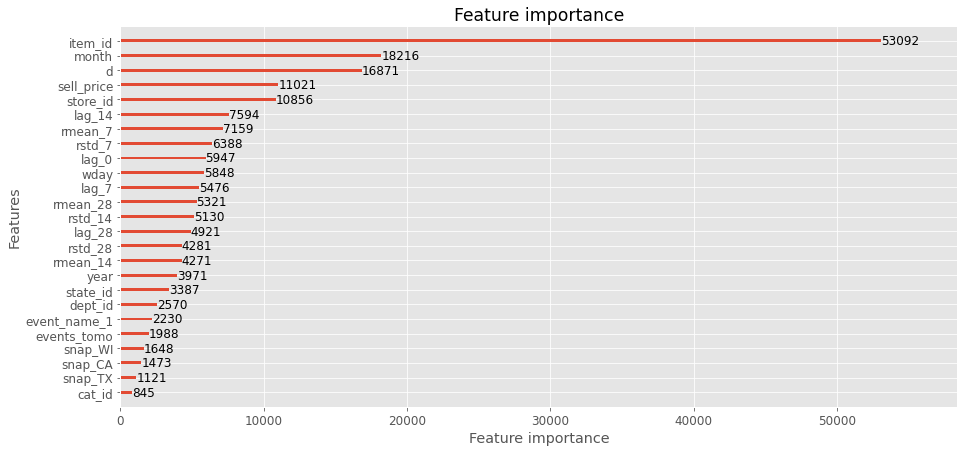

# Multi-Step Sales Forecasting of Walmart Products

Master's research project (MSc Data Science and Analytics, Ryerson University, 2020): 28-day-ahead daily sales forecasts for all **30,490** item-store series in the Walmart [M5 dataset](https://www.kaggle.com/c/m5-forecasting-accuracy), comparing LSTM, MLP, LightGBM, and a hybrid LSTM + LightGBM model.

  



## Results

Root mean squared scaled error (RMSSE) on the held-out final 28 days. RMSSE compares each model's error with a naive "same as yesterday" forecast, so lower is better and anything below 1 beats the naive baseline.

| Model | Test RMSSE (28 days) | Improvement over naive |
|---|---|---|
| **LightGBM** | **0.773** | **22.7%** |
| LSTM | 0.805 | 20.5% |
| Hybrid (LSTM → LightGBM) | 0.798 | 20.3% |
| MLP | 0.811 | 18.9% |

Findings:

- Gradient boosting won on accuracy, and it was also simpler to build and much faster to train than the MLP on the same features.
- The LSTM beat the MLP, which shows the value of sequence models on this data.
- The hybrid did not beat its parts: its accuracy tracked its first component.
- Every model struggled most with the `FOODS_3` department, which suggests per-department models as future work.

Full write-up: [research paper](report/Moeen%20Bagheri%20-%20Major%20Research%20Paper.pdf) · [poster](report/Moeen%20Bagheri%20-%20Poster.pdf) · [literature review and EDA](report/literature_review/Moeen%20Bagheri%20-%20Literature%20Review%20and%20Exploratory%20Data%20Analysis.pdf)

## Approach

- **Data.** Daily unit sales for 3,049 products in 3 categories and 7 departments, sold in 10 stores across California, Texas, and Wisconsin, from 2011-01-29 to 2016-06-19 (1,941 days), plus prices, calendar events, and SNAP days.
- **Split.** Days 1 to 1,885 for training, the next 28 for validation and hyperparameter search, the last 28 for testing.
- **One global model** across all series, so the models can learn shared demand patterns and cross-item effects instead of fitting 30,490 separate models.
- **Recursive multi-step forecasting.** Each model predicts one day ahead, and that forecast feeds the next day's features until the 28-day horizon is filled.
- **Features.** Sales lags (0, 7, 14, 28 days), rolling means and standard deviations (7, 14, 28 days), sell price, calendar fields, event flags (including "event tomorrow"), SNAP days, and item, department, category, store, and state identifiers.
- **Tuning.** Bayesian optimization of layers, units, learning rate and decay, dropout, batch size, batch normalization, and LSTM lookback for the neural nets; learning rate, feature fraction, L2, minimum leaf data, and number of leaves for LightGBM.



## Repository layout

```
code/Major_Research_Project.ipynb   EDA, feature engineering, all four models, evaluation
models/                             trained models and training logs (LightGBM text models, Keras .h5 via Git LFS)
report/                             paper, poster, and LaTeX source with every figure
data/                               place the Kaggle CSVs here (not committed)
requirements.txt
```

## Running it

1. Download `calendar.csv`, `sell_prices.csv`, and `sales_train_evaluation.csv` from the [M5 Forecasting - Accuracy](https://www.kaggle.com/c/m5-forecasting-accuracy/data) competition (Kaggle account and rules acceptance required) into `data/`.
2. `pip install -r requirements.txt`
3. The notebook reads `data/` and `models/` under `proj_dir`, which defaults to the working directory. Start Jupyter from the repository root, or set `proj_dir = '../'` in the Imports cell, then run it. Intermediate `.h5` datasets are written to `data/` on the first run. Trained models in `models/` can be loaded instead of retraining.

## Tech stack

Python, pandas, NumPy, TensorFlow/Keras, LightGBM, scikit-learn, bayesian-optimization, Matplotlib, LaTeX.

## Author

[Moeen Bagheri](https://moeenbagheri.com)
